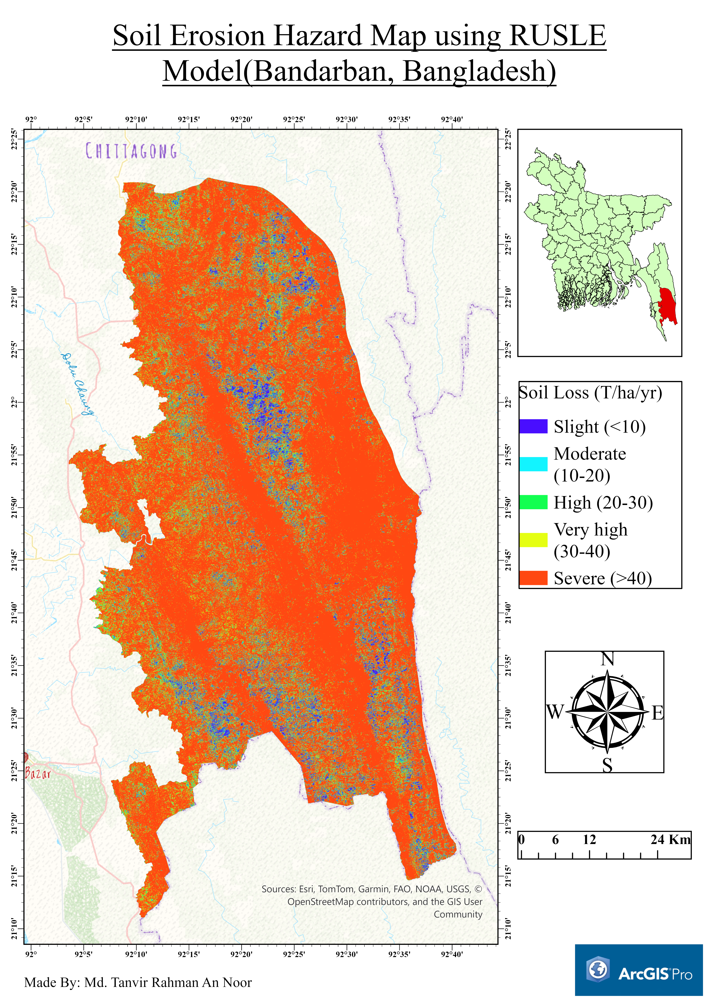

# RUSLE Soil Loss Assessment & Terrain Modeling of Bandarban District

* **Tools Used:** Google Earth Engine (JavaScript API), ArcGIS Pro
* **Datasets:** Multi-source Satellite Imagery & Copernicus 30m Digital Elevation Model (DEM)
* **Methodology:**
  1. **RUSLE Soil Erosion Modeling:** Calculated R, K, LS, C, and P erosion factors to generate a watershed soil loss hazard map.
  2. **Morphometric Terrain Modeling:** Extracted elevation, slope, aspect, hillshade, and Topographic Position Index (TPI) from 30m Copernicus DEM data.

### 1. RUSLE Soil Loss Hazard Map

### 2. Multi-Parameter Terrain Model (DEM, Slope, Aspect, Hillshade, TPI)

